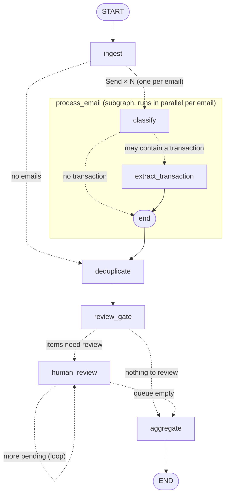

# Email Triage & Spend Tracker (LangGraph)

A LangGraph workflow that reads a batch of emails and sorts each one into **Work**, **Online Orders**, **Subscriptions** or **Miscellaneous**. It extracts spending data from every email that records a payment and sends doubtful or large items to a human reviewer. It then answers: *"How much did I spend this month, and where?"*

```
python main.py            # runs on emails.json, pauses at the first human review
```

| LangGraph feature | Where |
|---|---|
| Typed state (`TypedDict`) + `operator.add` reducers | [`state.py`](state.py) |
| Parallel fan-out with the **Send API** | `dispatch_emails` in [`nodes.py`](nodes.py) |
| Subgraph with a **conditional edge** (classify → extract or skip) | `build_email_subgraph` in [`graph.py`](graph.py) |
| **`interrupt()`** human review, looping one item at a time | `human_review` in [`nodes.py`](nodes.py) |
| **SQLite checkpointer**, resume from a new process with the same `thread_id` | [`graph.py`](graph.py), [`main.py`](main.py) |
| Structured LLM output (`with_structured_output` + Pydantic) | [`schemas.py`](schemas.py), [`llm.py`](llm.py) |
| Rendered diagram (`get_graph(xray=True).draw_mermaid()`) | [`diagrams/graph.mmd`](diagrams/graph.mmd) |

---

## 1. Architecture



The exact diagram generated by `graph.get_graph(xray=True).draw_mermaid()` is in [`diagrams/graph.mmd`](diagrams/graph.mmd). Regenerate it with `python main.py diagram`.

### Node-by-node

| Node | Kind | What it does | Why it is its own node |
|---|---|---|---|
| `ingest` | parent | Loads `emails.json` (or `raw_emails`), validates each email with Pydantic, and skips malformed or duplicate-id emails with an error record. | A bad input record is rejected once, at the boundary. |
| `dispatch_emails` | conditional edge | Returns one `Send("process_email", {"email": e})` per email. | This is the map step. |
| `classify` | subgraph | LLM structured output → `{category, confidence, reason, may_contain_transaction}`. Retries, then falls back to rules. | It is the only node that decides the category. |
| `route_after_classify` | conditional edge | Sends the email to `extract_transaction` if **any** of these hold: the LLM flag is true, the category is Online Orders, or a deterministic signal fires (the word *invoice*, or an amount next to payment wording). Otherwise → `END`. | Routing is tuned for recall. Precision is the extractor's job. |
| `extract_transaction` | subgraph | LLM structured output → amount, currency, merchant, date, category, payment method and order id. Then a **grounding check**: the amount must literally appear in the email, or it is set to null. | Extraction is only paid for when needed, and it is validated separately. |
| `deduplicate` | parent | Merges transactions that describe the same purchase (see §6). | Dedup needs **all** transactions, so it must run after fan-in. |
| `review_gate` | parent | Builds the review queue: confidence < 0.7, or amount > threshold, or a fallback extraction. | This keeps the policy (which items need review) separate from the mechanism (`interrupt`). |
| `human_review` | parent | `interrupt()`s for **one** pending item. The conditional edge loops back here until the queue is empty. | One interrupt per node execution gives one checkpoint per decision, and re-execution stays simple. |
| `aggregate` | parent | Applies the human decisions, then computes the totals. | It is pure and deterministic, so it is unit-tested without the graph. |

### Why Send (parallel) instead of a loop

I chose **Send for the LLM work and a sequential loop for the human work**:

* Classifying or extracting one email does not depend on any other email. Running them in parallel (bounded by `MAX_CONCURRENCY`) cuts wall-clock time roughly by the concurrency factor. With a real LLM that is the difference between ~40 sequential calls and ~10 rounds.
* The fan-out target is a **compiled subgraph**. That way `classify → extract` routing is a real `add_conditional_edges` evaluated on the *per-email* state. A conditional edge in the parent graph would only see the merged parent state.
* Interrupts happen **after** fan-in, never inside parallel branches. LangGraph does support concurrent interrupts, but then a resume has to map interrupt ids to answers. A single review queue after dedup is easier to reason about. It also means the reviewer never sees the same purchase twice, and each decision is its own checkpoint.
* The trade-off: the reviewer waits until every email has been processed. For a batch job that is acceptable. For streaming ingestion, see "Future improvements".

---

## 2. State schema ([`state.py`](state.py))

```python
class TriageState(TypedDict, total=False):
    source_path: str; raw_emails: list[dict]; as_of: str | None     # input
    emails: list[dict]                                               # ingest
    classifications: Annotated[list[dict], operator.add]             # parallel workers
    transactions:    Annotated[list[dict], operator.add]             # parallel workers (raw)
    errors:          Annotated[list[dict], operator.add]             # any node
    deduped_transactions: list[dict]                                 # deduplicate
    review_queue: list[dict]                                         # review_gate
    review_decisions: Annotated[list[dict], operator.add]            # human_review (loop)
    final_classifications: list[dict]; final_transactions: list[dict]; summary: dict  # aggregate

class EmailState(TypedDict, total=False):        # per-email subgraph
    email: dict
    classification: dict                         # local, read by the router
    classifications / transactions / errors      # same reducers -> flow back to the parent
```

* **Reducers** are used exactly where several writers append: N parallel workers, plus the review loop that runs many times. Single-writer keys simply overwrite.
* **Raw LLM output is never mutated.** Human decisions are stored append-only in `review_decisions` and applied in `aggregate`. The checkpoint therefore always shows both what the model said and what the human changed.
* Values are plain JSON dicts, so the SQLite checkpointer needs no custom serializer.

---

## 3. Prompts and structured output ([`prompts.py`](prompts.py), [`schemas.py`](schemas.py))

* **Structured output only.** `chat_model.with_structured_output(Classification)` and `(ExtractedTransaction)` use the provider's tool/JSON-schema calling. The `category` field is a `Literal` of the four categories and `confidence` is bounded `0..1` by Pydantic. A malformed response raises a validation error, which is retried like any other failure. Nothing parses free text.
* **The classifier prompt** gives each category a definition plus explicit **tie-break rules** for the ambiguous cases the assignment asks for:
  1. a work invoice is Work;
  2. a renewal that charges a card is Subscriptions;
  3. a promo from a store you ordered from is Miscellaneous.

  It asks for calibrated confidence and a `may_contain_transaction` flag ("a price in an advert is NOT a transaction").
* **The extractor prompt** says null is always acceptable, that the amount must be copied from the text, and that the email header date must not be used as the transaction date.
* **Defending against prompt injection:** email content is wrapped in `<email>` tags and declared untrusted.
* `temperature=0`; the default models are cheap and fast (`claude-haiku-5-5` / `gpt-4o-mini`), since this is classification and extraction rather than reasoning.
* **Spend categories** are a fixed `Literal` list (Shopping, Electronics, Food & Dining, Travel, …), so aggregation groups consistently.

### How the extractor is stopped from inventing amounts (defence in depth)

1. The router skips extraction for emails with no money signal at all.
2. The prompt makes null the safe default.
3. `amount` is `Optional[float]` in the schema, so the model is never forced to fill it.
4. **Grounding check** (`postprocess_extraction`): the amount must appear among the numbers written in the subject or body, after Indian/Western thousands separators are normalised (`1,23,456.50`). If it does not appear, it is discarded and a note is recorded. `"around two and a half thousand"` never becomes 2500.
5. `is_transaction=False` produces **no row at all**.
6. Unpriced transactions are listed in the summary but never summed.

---

## 4. Human-in-the-loop ([`review.py`](review.py), `human_review` in [`nodes.py`](nodes.py))

**Triggers** (configurable in `.env`):
* classification confidence `< REVIEW_CONFIDENCE_THRESHOLD` (default 0.7);
* amount `> SPEND_REVIEW_THRESHOLD_INR` (default ₹10,000). Foreign currencies are converted with an approximate static table **only for this comparison**; an unknown currency always goes to review;
* extraction that came from the fallback rules.

There is one review item per **email**, showing the classification and its (deduplicated) transaction together. A merged transaction is reviewed once.

**Mechanism:**
```python
response = interrupt(payload)               # graph pauses; payload shown to the reviewer
decision = ReviewDecision.model_validate(response)   # approve | reject | correct (+ fields)
return {"review_decisions": [decision...]}  # append-only
```
* `approve` keeps the item. `reject` excludes the transaction from spend. `correct` patches `category` and/or `amount, currency, merchant, date, spend_category, payment_method`. A correction on an email with no transaction creates one, entered by the human.
* An invalid resume value (e.g. `{"action": "maybe"}`) does **not** crash the run. The node calls `interrupt()` again with an `error` field (LangGraph matches multiple interrupts in one node by order).
* When the graph resumes, LangGraph **re-runs the node from the top**, so everything before `interrupt()` is side-effect free.

### Checkpointing and resumption

`SqliteSaver` writes every super-step to `checkpoints.sqlite`. `python main.py` can exit at the interrupt. Later, `python main.py resume --thread-id <id> --action approve` builds a **new graph object in a new process**, finds the pending interrupt in the checkpoint, and calls `graph.invoke(Command(resume=decision), {"configurable": {"thread_id": id}})`. No LLM call is repeated: `test_resume_from_new_process_with_sqlite_checkpointer` asserts the second client receives zero calls.

---

## 5. Error handling

| Failure | Behaviour |
|---|---|
| LLM error / timeout / invalid structured output | `call_with_retry`: `LLM_MAX_RETRIES` attempts with exponential backoff (provider SDK retries are disabled so they don't multiply). |
| Still failing (classify) | Rule-based fallback category with confidence capped at **0.5**, so the item is guaranteed to reach a human. If the rules themselves crash → Miscellaneous, confidence 0. |
| Still failing (extract) | Rule-based fallback extraction, `extraction_method="fallback_rules"`, which forces review. |
| Malformed email in the JSON | Skipped at `ingest` with an error record; the other emails continue. |
| Bad reviewer input | The CLI validates it before resuming; inside the graph, the node interrupts again. |

Every handled error is collected in `state["errors"]` and printed at the end. One bad email never stops the batch: `test_whole_run_survives_a_dead_llm` runs the graph with an LLM that always fails.

---

## 6. Deduplication ([`dedup.py`](dedup.py))

An order confirmation, a receipt and a shipping or delivery notice often describe one purchase. Two transactions are merged when:

1. **Both have an order/invoice id** → they are duplicates if and only if the normalised ids are equal (`#402-118` == `402-118`). Different ids are **never** merged: two genuine ₹349 Zomato orders on consecutive days stay separate.
2. **Otherwise:** same normalised merchant (`Amazon.in` == `amazon`), same currency, same amount, and effective dates within `DEDUP_WINDOW_DAYS` (default 3). Monthly renewals 30 days apart are not merged.
3. **A same-merchant notice with no amount** (e.g. "Delivered: your order") within the window is folded into the priced record instead of becoming a separate unpriced row.

Merging keeps the most complete record, fills its null fields from the duplicate, and records `source_email_ids`. The result does not depend on input order (this is tested). In the sample data, three pairs merge: Amazon (e001+e004), Flipkart (e011+e012) and Myntra (e022+e023).

---

## 7. Aggregation ([`aggregation.py`](aggregation.py))

* **Month-to-date** is relative to `--as-of` (default: the newest email's date, so the demo does not depend on today's date). `python main.py summary --month 2026-10` reports a full past month.
* The effective date is the transaction date when the email states one; otherwise it is the email's date. The `date` field itself stays null, so nothing is invented.
* Totals are **per currency**: ₹ and $ are never summed with a guessed exchange rate.
* The output covers: total, spend by spend-category, by merchant, by email-category, email count per category (zero counts included), unpriced transactions, and transactions outside the period.

---

## 8. Setup

```bash
git clone <your-repo-url> && cd email-triage-spend-tracker
python -m venv .venv
# Windows: .venv\Scripts\activate     macOS/Linux: source .venv/bin/activate
pip install -r requirements.txt
cp .env.example .env        # then add one key: GOOGLE_API_KEY / GROQ_API_KEY (free) or ANTHROPIC / OPENAI
```

Requires Python 3.11+ (developed and tested on 3.12 with langgraph 1.2, langchain-core 1.8, pydantic 2.14).

| Variable | Default | Meaning |
|---|---|---|
| `LLM_PROVIDER` | `auto` | `anthropic`, `openai`, `gemini`, `groq`, `rules` (offline) or `auto` (first key found) |
| `LLM_MODEL` | provider default | e.g. `claude-sonnet-5-5`, `gpt-4.1-mini` |
| `REVIEW_CONFIDENCE_THRESHOLD` | `0.7` | confidence below this → review |
| `SPEND_REVIEW_THRESHOLD_INR` | `10000` | amount above this (INR equivalent) → review |
| `DEDUP_WINDOW_DAYS` | `3` | same-purchase window |
| `LLM_MAX_RETRIES` / `LLM_RETRY_BASE_DELAY` | `3` / `1.0` | retry policy |
| `MAX_CONCURRENCY` | `4` | parallel Send workers |
| `CHECKPOINT_DB` | `checkpoints.sqlite` | SQLite checkpoint file |

**Free keys:** Gemini (`GOOGLE_API_KEY`, [aistudio.google.com/apikey](https://aistudio.google.com/apikey), default `gemini-3.8-flash`) and Groq (`GROQ_API_KEY`, [console.groq.com/keys](https://console.groq.com/keys), default `openai/gpt-oss-120b`) both have free tiers that need no card. Free tiers are rate-limited (a few requests per minute). Keep `MAX_CONCURRENCY` low (1–2), and the built-in retry with backoff absorbs occasional 429s.

**No API key?** `LLM_PROVIDER=auto` falls back to `rules`: a transparent keyword/regex engine (`rules.py`) that is also the LLM fallback. With it the whole graph, including interrupts and checkpointing, runs offline. Its results are clearly labelled ("Keyword rules matched …"). It is a demo and safety net, not a replacement for the LLM.

## 9. How to run

```bash
python main.py                                   # = python main.py run; stops at the first review
python main.py status                            # where is the last run paused?
python main.py resume --action approve
python main.py resume --action reject --note "company pays this"
python main.py resume --action correct --set amount=42000 --set category=Work --set merchant="Pixelcraft Studio"
python main.py resume --interactive              # answer the rest in the terminal
python main.py run --interactive                 # answer reviews as they come
python main.py run --auto-approve                # demo: approve everything, print summary
python main.py summary --month 2026-10           # "what did I spend in October?"
python main.py summary --category Subscriptions  # filter by spend or email category
python main.py diagram                           # regenerate diagrams/graph.mmd
```
`resume`, `status` and `summary` use the last run's thread id unless you pass `--thread-id`.

## 10. Tests

```bash
pytest -q                 # 64 tests, no API key needed (~3 s)
pytest -m live            # optional: 7 checks against a real LLM (passed 7/7 on Groq gpt-oss-120b)
```

| File | Covers |
|---|---|
| `test_classification.py` | all 4 categories, the 3 ambiguous cases from the brief, a low-confidence email, schema bounds, `with_structured_output` wiring (stub model), retry-then-succeed, fallback after retries, a full run with a dead LLM |
| `test_extraction.py` | amount/currency/merchant/payment method, grand total vs line items, USD, no transaction for ordinary email, a future charge is not a transaction, missing amount stays null, vague words not converted, hallucinated amount discarded, extractor fallback |
| `test_routing.py` | work invoice routed even when the LLM says no, ordinary/newsletter/promo skipped, Send fan-out, review loop routing, extractor called only for expected emails (end-to-end) |
| `test_deduplication.py` | order-id merge with field fill, window match, different ids never merged, monthly renewals kept, unpriced notice folded, order independence, full sample inbox |
| `test_human_review.py` | trigger rules, interrupt → approve / reject / correct, several interrupts in sequence, invalid resume value, correction that adds a transaction, **resume from a new graph + new SQLite connection** |
| `test_aggregation.py` | MTD per currency, per category / merchant / email-category, unpriced excluded, zero-count categories, full-month query |

LLM behaviour in tests is supplied by `ScriptedClient` and `FailingClient` (see `tests/conftest.py`), which are injected through `build_graph(client=...)`. Tests therefore exercise the real graph, routing, reducers, interrupts and checkpointer deterministically. As a sanity check, I deliberately broke `is_duplicate` and the grounding check, and 5 tests failed as expected.

## 11. Sample output (offline `rules` provider)

```text
$ python main.py --thread-id demo-1
LLM: rules | thread_id: demo-1 | review: conf<0.7, amount>Rs.10,000
==============================================================================
HUMAN REVIEW REQUIRED  (5 pending)
==============================================================================
Email   : e008  from accounts@pixelcraft.studio
Subject : Invoice INV-2026-118 for October design work - Project Atlas
Reasons : amount 45,000.00 INR exceeds review threshold (Rs.10,000)
Class.  : Work (conf 0.80) - Keyword rules matched Work (5 of 6 signals).
Txn     : {"amount": 45000.0, "currency": "INR", "merchant": "Pixelcraft", ...}

Run paused at the review gate (thread_id=demo-1). Resume with one of:
  python main.py resume --thread-id demo-1 --action approve
  ...

$ python main.py resume --thread-id demo-1 --action reject --note "company pays vendor invoices"
$ python main.py resume --thread-id demo-1 --action approve          # MakeMyTrip ₹18,750
$ python main.py resume --thread-id demo-1 --action correct --set merchant="Shree Enterprises" --set spend_category=Shopping
$ python main.py resume --thread-id demo-1 --action correct --set category=Subscriptions   # Airtel postpaid
$ python main.py resume --thread-id demo-1 --action approve

TRANSACTIONS (after de-duplication)
txn-e001-e004        ₹2,499.00  Amazon      Electronics      UPI          date=2026-11-02
                     * merged from e001, e004
txn-e006               ₹349.00  Zomato      Food & Dining    Wallet       date=null
txn-e007               ₹349.00  Zomato      Food & Dining    Wallet       date=null
txn-e011-e012        ₹1,299.00  Flipkart    Electronics      Cash on Delivery
txn-e014            ₹18,750.00  MakeMyTrip  Travel           Credit Card  * review: approve
txn-e016                $10.00  GitHub      Software & SaaS  Credit Card
txn-e021          amount: null  BigBasket   Groceries        -
...
19 raw extractions -> 16 unique transactions

SPEND SUMMARY  2026-11-01 to 2026-11-16 (month-to-date)
Total spend : ₹28,840.50, $10.00
By spend category:  Electronics ₹3,798.00 | Entertainment ₹768.00 | Food & Dining ₹1,184.00 |
                    Shopping ₹3,029.00 | Software & SaaS $10.00 | Travel ₹19,062.50 | Utilities & Bills ₹999.00
By merchant:        Amazon ₹2,499.00 | MakeMyTrip ₹18,750.00 | Zomato ₹698.00 | Myntra ₹1,849.00 | ...
Emails per category: Work 4 | Online Orders 12 | Subscriptions 8 | Miscellaneous 4   (28 processed)
Transactions with no stated amount (not counted, never guessed): txn-e021 (BigBasket)
Excluded (outside period): txn-e024     # the October Netflix renewal
```

## 12. Design trade-offs

* **Recall-oriented routing + precision-oriented extraction.** A missed transaction is worse than an extra extraction call. The router therefore ORs three signals, and the extractor (with the grounding check) is allowed to answer "no transaction".
* **Review after dedup and in batch** rather than inline per email: fewer, non-duplicated questions, at the cost of later feedback.
* **Event-sourced decisions** (`review_decisions`) rather than mutating results: auditable, and resumes are idempotent.
* **No currency conversion in totals.** It is more honest, but you get one total per currency.
* **Closures for dependency injection** (`make_nodes(client, settings)`) rather than LangGraph runtime context: simpler to read and to test. Runtime context would be the choice for per-run config in a server.
* **A work invoice is counted as spend unless rejected.** Whether a vendor invoice is *personal* spend is a business decision. The large-amount gate puts it in front of a human, which is the point of the HITL step.

## 13. Known limitations

* Real-LLM check: `pytest -m live` passed **7/7** against Groq `openai/gpt-oss-120b` (free tier). That covers 5 classification edge cases (including the work invoice and the store promo), the Swiggy grand total (₹486), and BigBasket with no amount (stays null). That is 7 targeted checks, not a full accuracy benchmark. The sample output above comes from the offline rules provider.
* The rules provider is keyword-based: it is overconfident on some single-keyword matches and does not understand context the way an LLM does.
* One transaction per email: a receipt listing several separate charges is collapsed to the total.
* Refunds and cancellations are not modelled as negative spend.
* Dedup can wrongly merge two genuinely separate purchases with no order ids, the same merchant and amount, within 3 days. In that case it keeps both email ids so a reviewer can see it.
* A human correction that changes the category does not re-route the email (e.g. re-running extraction). The reviewer must supply the transaction fields.
* The FX table used for the threshold is static and approximate.
* Emails are plain-text bodies only (no HTML or attachments).

## 14. Future improvements and discussion points

* **10,000 emails/day:** run the graph per small batch or per email from a queue (SQS/PubSub) with `PostgresSaver`. Do cheap rule pre-filtering (newsletters/OTPs never reach the LLM), use provider batch APIs and prompt caching for the static system prompt, and persist transactions in Postgres with a unique `(merchant, order_id)` key so dedup works across batches. Reviews go to a queue UI instead of the CLI.
* **LLM vs rules:** rules suit amounts, currencies, order ids, sender-domain merchant lookup and known senders (cheap, exact, auditable). The LLM adds value for intent ("is this a charge or an advert?"), ambiguous categories, free-form merchants and new formats. This repo already uses rules as the guardrail around the LLM.
* **Hindi / multilingual:** the categories stay the same. Add language detection, few-shot examples in Hindi/Hinglish, handle Devanagari digits and "रु"/"₹", and make the grounding check normalise numerals.
* **PDF invoices:** add an attachment-parsing node before extraction (pdf text extraction, or a vision model for scans), and ground amounts against the attachment text.
* Persist transactions to SQLite and answer natural-language questions over them; flag recurring subscriptions and estimate their monthly total; Gmail API ingestion; a small FastAPI or Streamlit view of the summary and the review queue.
